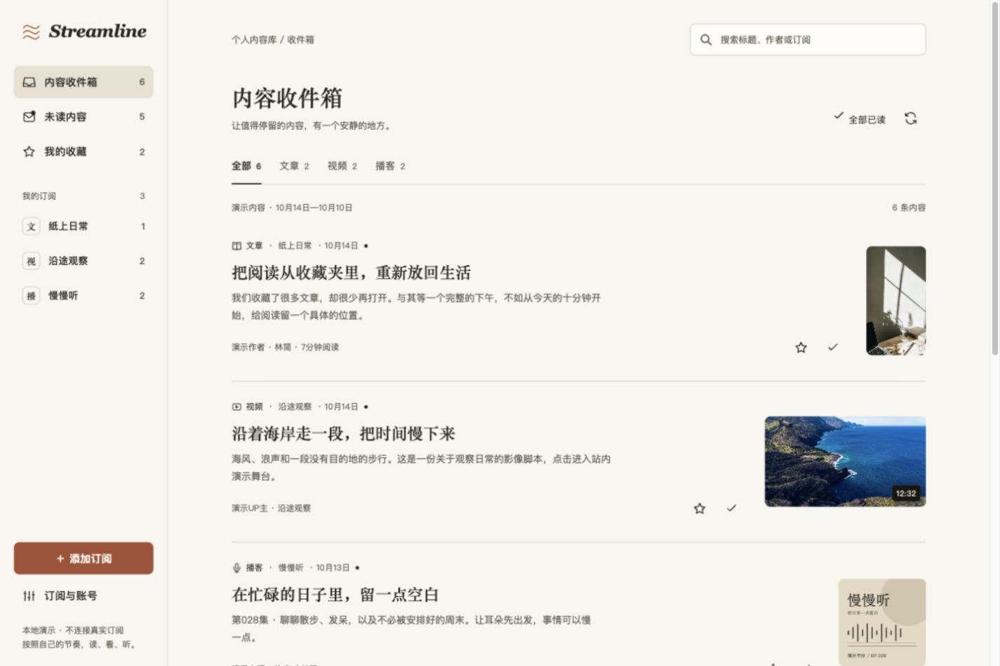

# Streamline — 文章、视频与播客的内容收件箱

把知乎文章、博客、B 站 / YouTube 频道和播客统一收进一条时间流，按自己的节奏阅读、观看和收听。

  

## 它解决什么问题

用暖白纸张、衬线标题和时间流，把三种内容放在同一个安静的界面中：

1. **粘贴什么都行** — 输入频道主页、UP 主空间或博客首页，自动找出背后的 RSS 地址，不用你去翻 feed URL。
2. **按内容类型浏览** — 文章、视频、播客分别呈现，和订阅、分类、未读、收藏、搜索组合使用；类型计数覆盖全部结果，不受分页限制。
3. **阅读与站内播放** — 文章在阅读面板展开；B 站使用站内原生播放器，YouTube 支持嵌入与备用取流；底部播客播放器支持进度、倍速和章节跳转，关闭详情或继续阅读时仍可收听。
4. **摘要不够就抓全文** — 只输出摘要的博客，一键把原文正文提取回来（保留代码块和图片）。
5. **浏览器出不了网也能看** — 自动探测；直连不通时改由服务端解析直链取流，用原生播放器播放。
6. **B 站可选登录** — 扫码登录后可尝试 1080P，显示平台实际返回的清晰度与分辨率；还能一键导入关注的 UP 主批量订阅。
7. **桌面与手机** — 手机订阅抽屉、全屏详情、迷你播放器；保留快捷键与键盘焦点管理。

知乎热榜可以直接订阅；其他知乎文章或作者订阅需要可用的 RSS 地址。播客连续播放仅在当前页面会话中保留，刷新后恢复进度尚未实现。

## 快速开始

需要 Node.js 22.15+（推荐 Node.js 24 LTS）。

```bash
git clone https://github.com/whynpt/rss-reader.git
cd rss-reader
npm ci

# 开发模式：API(8787) + 前端热更新(5173)
npm run dev
# 打开 http://localhost:5173

# 生产模式：构建后由 Node 单端口托管
npm run build && npm start
# 打开 http://localhost:8787

# 查询、计数与批量已读范围测试（独立临时数据库）
npm test
```

数据存放在 `data/reader.db`（SQLite）。删掉这个文件就等于重置。

仓库提供应用源码；运行时由本机 Node 服务保存数据并访问订阅源。当前版本面向个人使用，API 没有用户鉴权，部署时应限制为可信访问范围。



## 支持的订阅源

| 你粘贴的 | 实际订阅的 | 说明 |
|---|---|---|
| `youtube.com/@某频道` | `feeds/videos.xml?channel_id=UC…` | 自动抓取页面解析出频道 ID |
| `youtube.com/channel/UC…` | 同上 | 直接转换 |
| `youtube.com/playlist?list=PL…` | `feeds/videos.xml?playlist_id=PL…` | 订阅整个播放列表 |
| `youtube.com/watch?v=…` | 该视频作者的频道 | 从单个视频反查频道 |
| `space.bilibili.com/数字` | 内置 B 站接口 | 不依赖 RSSHub，见下方说明 |
| `知乎热榜` / `zhihu.com/hot` | 内置知乎热榜接口 | 不依赖 RSSHub |
| 播客订阅链接 | 原地址 | 标准 `<enclosure>` 音频 feed |
| 任意博客首页 | 自动发现的 feed | 读 `<link rel="alternate">`，找不到就试常见路径 |

> **关于 B 站**：官方网页端接口（api.bilibili.com）在很多网络环境下会触发风控直接 412，即使签了 WBI 也一样。改用安卓客户端的签名接口（`app.bilibili.com`）绕开风控，appkey/appsec 是社区长期公开的值，不需要登录、不需要 Cookie，速度通常在 1 秒以内。清晰度和可选登录见下方「B 站账号登录」一节。
>
> 番剧（`bangumi/media/mdxxx`）比较小众，仍走 [RSSHub](https://docs.rsshub.app)，需要自建实例：
> ```bash
> RSSHUB_BASE=http://localhost:1200 npm start
> ```

## 快捷键

| 键 | 作用 | 键 | 作用 |
|---|---|---|---|
| `j` / `↓` | 下一条 | `s` | 收藏 |
| `k` / `↑` | 上一条 | `m` | 切换已读 |
| `o` | 打开原文 | `r` | 刷新全部 |
| `/` | 搜索 | `n` | 添加订阅 |
| `Esc` | 关闭详情 | | |

## 网络受限环境（企业代理）

如果你的 shell 里配了 `http_proxy` 但**系统代理没开**，会出现一个别扭的局面：Node 能出网（抓 feed 正常），浏览器不能（YouTube 内嵌播放器一片空白）。

应用会在启动时探测一次（直接探 `youtube-nocookie.com`，而不是图片 CDN——两者可达性未必一致），发现浏览器直连不到视频站，就自动改用：

```
yt-dlp 服务端解析直链  →  /api/media 同源流代理  →  原生 <video> 播放
```

需要本机有 `yt-dlp`（`brew install yt-dlp`）。解析结果按直链自带的 `expire` 缓存，同一视频再打开是秒开。

> 受限于原生 `<video>` 只能播音视频合流格式，这条路径通常是 360p。想要高清就把系统代理打开，走回内嵌播放器。

## B 站账号登录（可选）

不登录也能用——B 站视频默认由服务端取流，在站内播放器播放，选择高清不会自动跳转到 B 站网页。侧栏点「登录 B 站账号」扫码登录后：

- 视频详情页可选择 **1080P / 720P**，并显示平台实际返回的清晰度；1080P 是否可用取决于账号权限和视频格式。登录后自动重新取流，避免复用匿名播放缓存。
- 侧栏多一个「导入关注」入口，一次性把关注的 UP 主批量订阅（已订阅过的自动跳过）
- 联合投稿按订阅的 UP 主 UID 获取空间名称，侧栏和视频署名显示该 UP 主，不带「等联合创作」。

```
扫码登录（TV 端协议） → access_token 落盘 data/bilibili_auth.json → 播放/关注列表请求带上它
```

登录凭证只存在本机（`data/` 整个目录都在 `.gitignore` 里，不会被提交），退出登录会清除这个文件。凭证有效期约 1 个月，过期后重新扫码即可。

> 受限于原生 `<video>` 只能播渐进式合流格式（不支持 MediaSource 拼接分离流），目前拿到的分辨率上限是 1080P；4K/高帧率这类只有 DASH 分离流的清晰度暂不支持。

## 项目结构

```
server/
  index.js            Express 路由、静态托管
  db.js               node:sqlite 建表与查询（feeds / entries）
  feeds.js            抓取、解析、视频元数据提取、定时刷新、B 站签名请求基础设施
  resolver.js         URL → feed 地址的智能解析、内嵌播放地址生成
  proxy.js            封面图代理 + 支持 Range 的音视频流代理
  fulltext.js         原文正文提取
  stream.js           yt-dlp 视频直链解析与缓存
  bilibili-auth.js    B 站扫码登录、凭证读写
  bilibili-stream.js  B 站播放地址解析（未登录 720P / 登录后更高）
  bilibili-follow.js  拉取登录账号的关注列表
src/
  App.jsx       状态编排、快捷键、分页、直连探测、B 站登录状态
  api.js        接口封装
  styles.css    纸张风格、时间流与响应式布局
  timestamps.js Show Notes 时间点解析
  components/
    Sidebar.jsx                订阅、分类与账号导航
    EntryList.jsx              三种内容的时间流
    EntryDetail.jsx            阅读、视频与节目详情
    VideoPlayer.jsx            站内视频、清晰度与备用取流
    PlaybackProvider.jsx       跨详情持续播放与音视频互斥
    PersistentAudioPlayer.jsx  底部播客控制条
    Modal.jsx                  原生弹窗及焦点管理
    AddFeedDialog.jsx          订阅表单与地址校验
    Bilibili*Dialog.jsx        扫码登录与关注导入
```

原型位于 `designs/rss-redesign/index.html`；实际应用入口为 `/`，实现与验收记录见 `designs/rss-redesign/IMPLEMENTATION.md`。

## 几个实现上的决定

**用 `node:sqlite` 而不是 better-sqlite3** — 使用 Node 内置的 SQLite 支持，省掉原生模块编译，`npm install` 不会因为编译工具链失败。

**播客音频必须走 Range 代理** — 播客的 mp3 普遍是统计跳转：`traffic.megaphone.fm/x.mp3` → 302 → `CDN?key=签名&session_id=…`，每次请求签发的 token 都不同。直接把这个地址喂给 `<audio>`，浏览器一拖进度条就重新请求，拿到的是另一个 session 的签名，于是拖不动也放不出声。`/api/media` 在服务端跟随跳转、转发 `Range` 头、如实回传 `206 / Content-Range / Accept-Ranges`，播放器才能拿到总时长并支持拖动。

**封面向图床要小图** — 播客封面常是 3000×3000 原图，imgix 现场缩放能拖到 20 秒以上，而我们只显示 270px 宽。代理层把 `max-w=3000` 改写成 `w=480`，同一张图从超时变成 0.4 秒、13KB。

**失败的封面要负缓存** — 否则每次滚动都去撞同一堵墙，日志被刷屏。超时按 60 秒冷却（图床多半在冷渲染，等会儿就好），4xx/5xx 按 10 分钟冷却。

**内嵌播放器不能设 `no-referrer`** — YouTube 嵌入播放器靠 referrer 校验来源站点，收不到就直接报「错误 153」。实测同一视频、同一页面，唯一差别是 `referrerpolicy`：`no-referrer` → `ERROR_153`，`strict-origin-when-cross-origin` → `READY`。后者只发送源、不含路径，既能过校验也不泄漏具体在读哪篇。

**播放失败要能自动兜底** — 播放器出错（嵌入受限、地区限制等）时只在 iframe 内部画一块错误图，外面拿不到任何信号。加上 `enablejsapi=1&origin=` 后可通过 postMessage 捕获错误码，自动切到本地播放。

**代理只允许公网地址** — 挡掉 `localhost`、`127.*`、`10.*`、`192.168.*` 等，避免这个接口变成打进内网的跳板。

**直链解析要能重试** — YouTube 限流时会只返回分离的音视频流，此时所有合流格式都选不中。碰到「format is not available」就换个更宽松的格式（itag 18）隔一会儿重试，多数情况即可恢复。

**feed 内容先消毒再入库** — 第三方 HTML 不可信，写库前剥掉 `<script>`、`<iframe>`、`on*` 事件属性和 `javascript:` 链接。

**YouTube 频道 ID 优先读 canonical** — 频道页 HTML 里散落着大量「推荐频道」的 ID，取第一个匹配会订阅到别人；`<link rel="canonical">` 才唯一指向当前频道。

**B 站改用安卓客户端签名接口** — 网页端 `api.bilibili.com` 的公开接口（包括签了 WBI 的）在很多网络环境下直接 412（安全风控），和登录状态无关。改用 `app.bilibili.com` 的签名方案（`appkey`+`ts` 参与排序拼接、MD5 签名）绕开风控，无需 Cookie，一次请求通常在 1 秒以内。

**B 站清晰度上限是服务端强制的** — 实测未登录状态下，不管请求 `durl`（渐进式 mp4）还是 `dash`（分离流）格式，不管显式请求多高的 `qn`，实际拿到的都会被服务端压到 720P。这不是接口参数的问题，登录之后（甚至大会员）才能解锁更高档位。

**B 站直链走 durl 而不是 dash** — dash 格式音视频分离，原生 `<video>` 播不了，需要 MediaSource Extensions 手动拼流。`durl`（渐进式 mp4）虽然清晰度封顶稍低（免登录 720P、登录 1080P），但能直接复用已有的 `/api/media` Range 代理架构，不需要额外写一套 MSE 播放器。

**B 站扫码登录用 TV 端协议而不是网页端** — 网页端扫码登录（`passport.bilibili.com/qrcode/h5`）走的是浏览器 Cookie 体系，服务端拿不到；TV 端协议（`passport-tv-login`）设计上就是给第三方设备用的，直接返回 `access_token`，配合已有的 APP 签名机制无缝复用。

## 配置

| 环境变量 | 默认值 | 说明 |
|---|---|---|
| `PORT` | `8787` | API 端口（Vite 代理会跟着走） |
| `WEB_PORT` | `5173` | 开发模式前端端口 |
| `DB_PATH` | `data/reader.db` | 数据库位置 |
| `RSSHUB_BASE` | `https://rsshub.app` | RSSHub 实例地址（仅番剧订阅需要） |
| `BILI_AUTH_PATH` | `data/bilibili_auth.json` | B 站登录凭证存放位置 |
| `REFRESH_MINUTES` | `30` | 后台自动刷新间隔（最小 5） |

## 后续可以做

- 打包成桌面 App（Tauri 套壳，现成的 Web 界面直接复用）
- 接 `yt-dlp` 做视频离线下载归档
- OPML 导入导出，方便从 Feedly / Inoreader 迁移
- 记住播客播放进度，下次接着听
